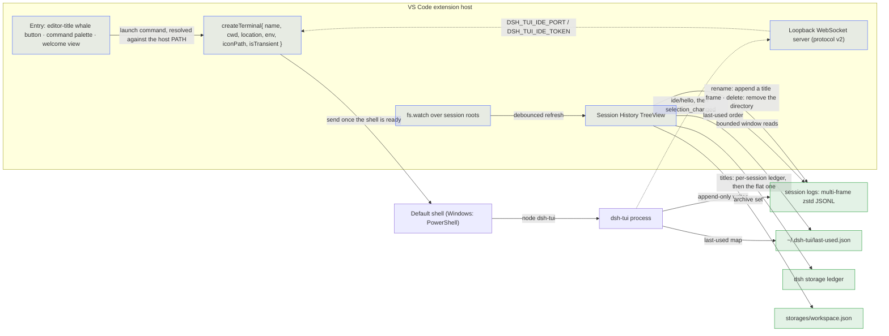

<div align="right">

English · [中文](CONTRIBUTING_ZH.md)

</div>

# Contributing to dsh-tui-vscode

Thank you for considering contributing to dsh-tui-vscode! The workflow and conventions below are **enforced server-side by CI** (contributors cannot weaken the checks by editing repo files).

## Development environment

- Node.js 24 (dev default; the CI test matrix runs Node 22/24); package management uses **npm** (`npm ci`).
- The e2e "real dsh-tui resume" test needs a global `dsh` CLI and `dsh-tui` (skipped automatically when absent).
- UAT that needs a real VS Code install with an isolated profile: `scripts/uat-devhost.ps1` (Windows PowerShell) — it strips the agent shell's `NO_COLOR`/`TERM` before launching (a host started from an agent shell otherwise renders the TUI in greyscale, LESSONS L-013) and prints the commit anchors the evidence must be pinned to (L-015) — it recompiles `out/` first (skip with `-SkipBuild`, which flags the anchor as not build-guaranteed) and locates the checkout and `Code.exe` without machine-specific paths (`-Repo` / `-CodeExe` / `DSH_UAT_CODE_EXE` override).
- Install the local hook for development: `node scripts/install-commit-hook.mjs` (blocks fast-to-revert issues like commit-message format).

## Source layout

```
dsh-tui-vscode/
├── src/
│   ├── extension.ts         # Activation: command registration, createTerminal, image-setup prompts
│   ├── session.ts           # Launch-command resolution (host PATH), env building, terminal placement
│   ├── sessions.ts          # Session data layer (multi-frame zstd, bounded reads, titles, filters, rename/delete)
│   ├── sessions-view.ts     # Session History TreeView
│   ├── session-watchers.ts  # fs.watch over the session roots
│   ├── relative-time.ts     # Compact relative timestamps
│   ├── at-mention.ts        # @-mention text generation
│   ├── auto-mention.ts      # Selection-push decisions
│   ├── status.ts            # Status-bar item
│   ├── ide/server.ts        # Loopback IDE selection-channel server
│   ├── test/                # node:test unit tests (session, sessions, at-mention, auto-mention, ide-server, session-watchers, relative-time)
│   └── test-suite/          # Real extension-host e2e (@vscode/test-electron)
├── media/                   # Icons and README imagery (packaged into the vsix)
├── l10n/                    # Runtime strings for vscode.l10n
├── scripts/                 # install-commit-hook, install-local, uat-devhost
├── .githooks/               # pre-commit / commit-msg
├── .github/                 # CI workflows, PR template, issue forms
├── docs/                    # Design notes (excluded from the vsix)
└── package.nls*.json        # Contribution-point strings (commands, views, settings)
```

## Architecture



Key points:

- **Session = real terminal.** The extension calls `createTerminal` and sends the launch command; the process, its signals, its scrollback and its clipboard belong to the terminal. The command is resolved to an absolute path against the **extension host's** PATH, because a login shell rebuilds `PATH` and cannot be trusted.
- **Specific-session resume** exports `DSH_TUI_RESUME_SESSION` for the profile's `cordis.patch.yml` to read at boot, and deliberately does not pass `--resume` — a bare `--resume` makes the launcher overwrite that variable from `~/.dsh-tui/resume.txt`.
- **Session history sources**, from [docs/session-history.md](docs/session-history.md): bounded window reads over multi-frame zstd logs, titles from the log event, then the storage ledger, then the first human prompt, then the working-directory name; filtered to the current workspace with empty, sub-agent and archived sessions hidden; ordered by last-used.
- **The IDE selection channel**, from [docs/ide-selection-channel.md](docs/ide-selection-channel.md): a loopback WebSocket server with a token handshake, advertised through the environment and a lock file, pushing debounced selection changes that dsh-TUI attaches verbatim.
- **The image capability gate**, from [docs/terminal-images.md](docs/terminal-images.md): three observations decide whether a session is given `sixel`, and the settings write is judged before it happens rather than after.

## Running tests

```bash
npm run typecheck        # tsc --noEmit
npm test                 # compile + data-layer unit tests (node:test)
npm run test:e2e         # real extension-host tests (@vscode/test-electron; Linux: xvfb-run -a)
npm run package          # compile + build the .vsix
```

## Change workflow

1. Branch from `main` with a **prefix** of `feat/` `fix/` `docs/` `chore/` `hotfix/` `ci/` `test/` (enforced by the CI pr-policy; `feature/` is rejected).
2. Commit messages follow **Conventional Commits**: `fix: ...` / `feat: ...` / `docs: ...` / `ci: ...` (CI audits every commit).
3. Open a Pull Request: the **title must also be Conventional Commits**; the body uses the five-section structure of `.github/PULL_REQUEST_TEMPLATE.md` (Summary / Scope of Changes / Verification / Self-check / Review Notes) — **deleting or omitting any section or checkbox fails the PR**. Checkbox lines (including full-width punctuation) are matched byte-exactly by CI — keep the template text as-is and only toggle `[ ]`/`[x]`; do not retype it from memory.
4. Behavior changes **must be recorded in the Unreleased section of `CHANGELOG.md`** (both languages); ticking "Behavior changes recorded in CHANGELOG (Unreleased)" requires an actual CHANGELOG diff against the base (no fake self-checks).
5. Docs are **English-primary**: write the canonical English file first, then sync the Chinese mirror under `*_ZH.md` (CI enforces a line-count difference of 0–10; CoC excluded).

## Code conventions

- Pure logic that does not need the VS Code API lives in `src/session.ts` / `src/sessions.ts` — **no `vscode` import** — so it is unit-testable.
- **Platform-independent assertions**: build expected paths with `join()`; CI runs on Linux and Windows, and hardcoded Windows-style separators fail on Linux (a lesson already learned).
- Stage explicit paths only — no `git add -A` grab-bags; run `git diff --check` before committing.
- Never commit credentials, keys, personal paths, or local artifacts (`.vsix`, `.e2e-workspace`, etc. are in `.gitignore`).
- **User-visible UI strings must go through the l10n pipeline**: runtime strings use `vscode.l10n.t()` and stay in sync with `l10n/bundle.l10n.json` (English identity) and `l10n/bundle.l10n.zh-cn.json`; contribution-point text (command titles, view names, setting descriptions) lives in `package.nls.json` / `package.nls.zh-cn.json` with identical key sets. Do not hardcode user-visible literals.

## Commit conventions

- One logical change per commit; no unrelated edits mixed in.
- Format: `<type>(<scope>): <subject>`, e.g. `fix(sessions): projectNameOf 双分隔符解析`.

## Submission flow

1. Fork this repository and branch from `main` (`git checkout -b fix/your-change`).
2. Commit your changes (`git commit -m 'fix: describe the change'`).
3. Push the branch (`git push origin fix/your-change`).
4. Open a Pull Request (title with a Conventional Commits prefix, same as commits).

Local pre-check: install the pre-commit hook (`node scripts/install-commit-hook.mjs`); CI covers the rest server-side.

## Continuous integration

`.github/workflows/ci.yml` runs on every push to `main` and on every pull request:

| Job | What it covers |
| --- | --- |
| `test` | Linux and Windows × Node 22 and 24: install, typecheck, unit tests |
| `e2e` | Linux under xvfb: the real extension-host suite, then `npm run package`, then a VSIX smoke test that the `zh-cn` contribution strings and runtime bundle really are inside the package |
| `quality` | Bilingual mirror symmetry (line counts within 10), the primary↔mirror cross links, a BOM guard, `package.nls*` and `l10n` key parity, `l10n.t` literal coverage, actionlint |
| `pr-policy` | Conventional Commits in the PR title and in every commit, the branch prefix, the PR template's sections and checkboxes, and the honesty of the CHANGELOG self-check |
| `release-consistency` | The five-point version match, plus a PR link (or an explicit direct-push marker) in every version section |
| `security-scan` | A credential scan over `HEAD` and a check that no credential-like file is tracked |
| `docs-links` | A lychee dead-link check over the root documents and `.github/` |

The e2e suite covers command registration, terminal creation with environment injection, input round-trip, multiple concurrent sessions, Ctrl+C termination, `--resume`, specific-session resume over the environment channel (asserting that no `--resume` is passed), the IDE selection channel's server lifecycle and WebSocket round-trip, the settings-scope and image-gating prompt paths, `imageProtocol: auto` actually removing an inherited variable, UI localisation, and a guarded test that resumes a real dsh-tui session.

## Publishing

- Current publishing flow: `npm run package` to build the vsix, then upload it at https://marketplace.visualstudio.com/manage (the official "manual publish" path — no PAT required).
- Version flow: bump `package.json` version → sync the README badges and CHANGELOG (the release-consistency CI enforces the five-point match) → create the `v*` tag → upload the new version via the web.
- Note: Azure DevOps global PATs are retired on 2026-12-01; for future CLI/CI automation, switch to Entra ID (`vsce publish --azure-credential`, vsce >= 2.26.1).
- Never use "Remove": an extension name is permanently reserved after removal and cannot be reused; use "Unpublish" to take it down.

### Publishing an update (new version)

1. **A new version number is mandatory**: Marketplace versions cannot be overwritten or reused after deletion — every release must use an incremented version number (uploading the same version is rejected).
2. **CHANGELOG**: move the `Unreleased` content into a version section `## [x.y.z] - date`, linking the PRs merged in this batch (the release-consistency CI requires a PR link or a direct-push marker in every version section).
3. **Five-point sync**: `package.json` version = README badges (zh/en) = first CHANGELOG version section (zh/en) — verified by CI.
4. `npm run package` to build the vsix.
5. **Compare the packaged size with the last release** before uploading: `gh release view <prev-tag> --json assets`. An order-of-magnitude jump means `.vscodeignore` is letting a local tool directory into the package — fix it before uploading (see LESSONS L-004 / L-018).
6. Upload the new vsix on the manage page (it becomes the extension's new version automatically, keeping install stats).
7. Create the `v*` tag and a GitHub Release (with the vsix attached), matching the store version.
8. After the release: reset `Unreleased` to empty; if the version sync touched README/CHANGELOG, push them together with the tag.
