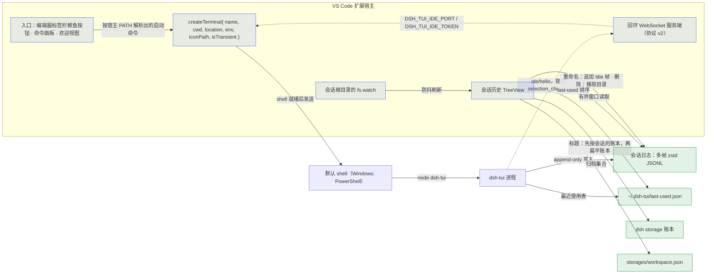

<div align="right">

[English](CONTRIBUTING.md) · 中文

</div>

# 贡献指南（dsh-tui-vscode）

感谢你考虑为 dsh-tui-vscode 做贡献！以下是参与开发的流程与约定，**均由 CI 服务端强制**（贡献者无法通过修改仓库文件削弱检查）。

## 开发环境

- Node.js 24（开发默认；CI 测试矩阵为 Node 22/24）；包管理用 **npm**（`npm ci` 安装）。
- e2e 的"真实 dsh-tui 恢复测试"需要本机全局安装 `dsh` CLI 与 `dsh-tui`（无则自动跳过该用例）。
- 需要真实安装的 VS Code + 隔离 profile 的 UAT：用 `scripts/uat-devhost.ps1`（Windows PowerShell）——它启动前剥离 agent shell 的 `NO_COLOR`/`TERM`（否则从 agent shell 起来的宿主会把 TUI 渲染成灰阶），并打印证据必须钉住的提交锚点——它会先重编译 `out/`（可加 `-SkipBuild` 跳过，此时输出会标注该锚点未经构建保证），并用与机器无关的方式定位检出目录与 `Code.exe`（可用 `-Repo` / `-CodeExe` / `DSH_UAT_CODE_EXE` 覆盖）。
- 开发时建议安装本地钩子：`node scripts/install-commit-hook.mjs`（拦截提交消息格式等快速可逆问题）。

## 源码布局

```
dsh-tui-vscode/
├── src/
│   ├── extension.ts         # 激活入口：命令注册、createTerminal、图片启用引导
│   ├── session.ts           # 启动命令解析（宿主 PATH）、环境构建、终端位置
│   ├── sessions.ts          # 会话数据层（多帧 zstd、有界读取、标题、过滤、重命名/删除）
│   ├── sessions-view.ts     # 会话历史 TreeView
│   ├── session-watchers.ts  # 会话根目录的 fs.watch
│   ├── relative-time.ts     # 紧凑相对时间
│   ├── at-mention.ts        # @ 引用文本生成
│   ├── auto-mention.ts      # 选区推送决策
│   ├── status.ts            # 状态栏项
│   ├── ide/server.ts        # 回环 IDE 选区通道服务端
│   ├── test/                # node:test 单测（session、sessions、at-mention、auto-mention、ide-server、session-watchers、relative-time）
│   └── test-suite/          # 真实扩展宿主 e2e（@vscode/test-electron）
├── media/                   # 图标与 README 图片（会打进 vsix）
├── l10n/                    # vscode.l10n 运行时文案
├── scripts/                 # install-commit-hook、install-local、uat-devhost
├── .githooks/               # pre-commit / commit-msg
├── .github/                 # CI 工作流、PR 模板、issue 表单
├── docs/                    # 设计记录（不进 vsix）
└── package.nls*.json        # 贡献点文案（命令、视图、设置）
```

## 架构



要点：

- **会话 = 真实终端。** 扩展只负责 `createTerminal` 与发送启动命令；进程、信号、滚动缓冲与剪贴板都归终端。启动命令按**扩展宿主**的 PATH 解析为绝对路径——登录 shell 会重建 `PATH`，不可信。
- **指定会话恢复**导出 `DSH_TUI_RESUME_SESSION` 供 profile 的 `cordis.patch.yml` 在启动时读取，并刻意不传 `--resume`——裸 `--resume` 会让启动器用 `~/.dsh-tui/resume.txt` 覆盖该变量。
- **会话历史数据源**见 [docs/session-history_ZH.md](docs/session-history_ZH.md)：在多帧 zstd 日志上做有界窗口读取；标题依次取日志事件、storage 账本、首条真人消息、工作目录名；按当前工作区过滤并隐藏空会话/子代理运行/已归档会话；按 last-used 排序。
- **IDE 选区通道**见 [docs/ide-selection-channel_ZH.md](docs/ide-selection-channel_ZH.md)：带回环 WebSocket 服务端与 token 握手，经环境变量与 lock 文件公布，推送防抖后的选区变化，由 dsh-TUI 原样附加。
- **图像能力门禁**见 [docs/terminal-images_ZH.md](docs/terminal-images_ZH.md)：三个观测决定会话是否拿到 `sixel`，而设置写入是在写入**之前**判定的，不是之后。

## 运行测试

```bash
npm run typecheck        # tsc --noEmit
npm test                 # 编译 + 数据层单元测试（node:test）
npm run test:e2e         # 真实扩展宿主测试（@vscode/test-electron；Linux 用 xvfb-run -a）
npm run package          # 编译 + 生成 .vsix
```

## 变更流程

1. 从 `main` 创建功能分支，**分支前缀**必须是 `feat/` `fix/` `docs/` `chore/` `hotfix/` `ci/` `test/`（CI pr-policy 强制，`feature/` 会被拒绝）。
2. 提交消息遵循 **Conventional Commits**：`fix: ...` / `feat: ...` / `docs: ...` / `ci: ...`（CI 逐个提交审计）。
3. 发起 Pull Request：**标题同样遵循 Conventional Commits**；正文使用 `.github/PULL_REQUEST_TEMPLATE.md` 的五段结构（摘要 / 改动范围 / 验证 / 自查 / 审查注意点），**删除或省略任何段落或勾选项即失败**。勾选项行（含全角标点）会被 CI 逐字节精确匹配——原样保留模板文本、只切换 `[ ]`/`[x]`，勿手打复述。
4. 行为变化**必须记入 `CHANGELOG.md` 的 Unreleased 段**（中英同步）；勾选"行为变化已记入 CHANGELOG"时，分支必须相对基线有实际的 CHANGELOG diff（防虚假自查）。
5. 文档改动**以英文为准**：先写无后缀的英文权威版，再同步 `*_ZH.md` 中文镜像（CI 强制行数差 0–10，CoC 除外）。

## 代码约定

- 与 VS Code API 无关的纯逻辑放 `src/session.ts` / `src/sessions.ts`，**不带 `vscode` import**，便于单元测试。
- **断言平台无关**：路径分隔符用 `join()` 构造期望值；CI 在 Linux 与 Windows 双平台运行，Windows 风格硬编码断言会在 Linux 失败（已有前车之鉴）。
- 只暂存显式路径，不用 `git add -A` 大杂烩；提交前自查 `git diff --check`。
- 不提交凭据、密钥、个人路径或本地产物（`.vsix`、`.e2e-workspace` 等已在 `.gitignore`）。
- **用户可见 UI 文案必须走 l10n 管线**：运行时文案用 `vscode.l10n.t()`，并与 `l10n/bundle.l10n.json`（英文 identity）和 `l10n/bundle.l10n.zh-cn.json` 同步；贡献点文案（命令标题、视图名、设置描述）写在 `package.nls.json` / `package.nls.zh-cn.json` 且两组 key 必须一致。禁止硬编码用户可见字面量。

## 提交规范

- 每个变更单独提交，勿混入无关改动。
- 提交信息：`<type>(<scope>): <subject>`，如 `fix(sessions): projectNameOf 双分隔符解析`。

## 提交流程

1. Fork 本仓库，从 `main` 建分支（`git checkout -b fix/your-change`）。
2. 提交改动（`git commit -m 'fix: describe the change'`）。
3. 推送到分支（`git push origin fix/your-change`）。
4. 发起 Pull Request（标题同样遵循 Conventional Commits 前缀）。

本地预检：安装 pre-commit 钩子（`node scripts/install-commit-hook.mjs`），CI 服务端兜底其余检查。

## 持续集成

`.github/workflows/ci.yml` 在每次推送到 `main` 与每个 PR 上运行：

| Job | 覆盖什么 |
| --- | --- |
| `test` | Linux 与 Windows × Node 22/24：安装、typecheck、单测 |
| `e2e` | Linux + xvfb：真实扩展宿主套件，随后 `npm run package`，再用 VSIX 冒烟确认 `zh-cn` 贡献点文案与运行时 bundle 确实在包内 |
| `quality` | 双语镜像对称（行数差 ≤10）、主/镜像互链、BOM 防线、`package.nls*` 与 `l10n` 键一致、`l10n.t` 字面量覆盖、actionlint |
| `pr-policy` | PR 标题与每个提交的 Conventional Commits、分支前缀、PR 模板的段落与勾选项、CHANGELOG 自查的真实性 |
| `release-consistency` | 五处版本一致，以及每个版本段含 PR 链接（或显式 direct-push 标记） |
| `security-scan` | 对 `HEAD` 做凭据扫描，并检查没有凭据类文件被跟踪 |
| `docs-links` | 对根级文档与 `.github/` 跑 lychee 死链检查 |

e2e 覆盖：命令注册、带环境注入的真实终端创建、输入回环、多会话并发、Ctrl+C 终止、`--resume`、经环境通道的指定会话恢复（并断言未传 `--resume`）、IDE 选区通道的服务端生命周期与 WebSocket 回环、设置作用域与图像门禁的提示路径、`imageProtocol: auto` 确实移除继承来的变量、界面本地化，以及一个受保护的真实 dsh-tui 会话恢复测试。

## 发布 / Publishing

- 当前发布方式：`npm run package` 生成 vsix → https://marketplace.visualstudio.com/manage 网页上传（官方"手动发布"路径，无需 PAT）。
- 版本流程：改 `package.json` version → 同步 README 徽章与 CHANGELOG（release-consistency CI 强制五处一致）→ 打 `v*` tag → 网页上传新版本。
- 注意：Azure DevOps 全局 PAT 将于 2026-12-01 退休；届时如需 CLI/CI 自动化发布，改用 Entra ID（`vsce publish --azure-credential`，vsce ≥ 2.26.1）。
- 切勿使用"移除（Remove）"：扩展名移除后**永久保留不可复用**；下架请用"Unpublish"。

### 更新发布（新版本）清单 / Publishing an update (new version)

1. **新版本号强制**：Marketplace 的版本**不可覆盖、删除后不可复用**——每次发布必须用**递增的新版本号**（同版本号网页上传会被拒绝）。
2. **CHANGELOG**：把 `Unreleased` 内容转为新版本段 `## [x.y.z] - 日期`，段内**链接本批已合并的 PR**（release-consistency CI 强制每版本段含 PR 链接或 direct-push 标记）。
3. **五处一致**：`package.json` version = README 徽章（中/英）= CHANGELOG 首个版本段（中/英），CI 验证。
4. `npm run package` 生成 vsix。
5. **上传前把产物大小与上一次发布比对**：`gh release view <prev-tag> --json assets`。数量级跳变说明 `.vscodeignore` 让某个本地工具目录进了包——上传前先修好。
6. 在 manage 页面**上传新 vsix**（自动成为该扩展的新版本，保留安装统计）。
7. 打 `v*` tag + 创建 GitHub Release（附 vsix 附件），与商店版本保持一致。
8. 发布后：`Unreleased` 重置为空段；如版本同步中改了 README/CHANGELOG，随 tag 一起推送。
