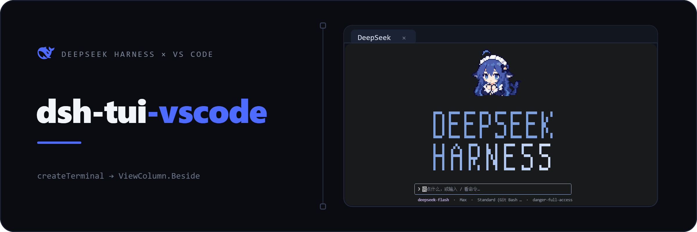
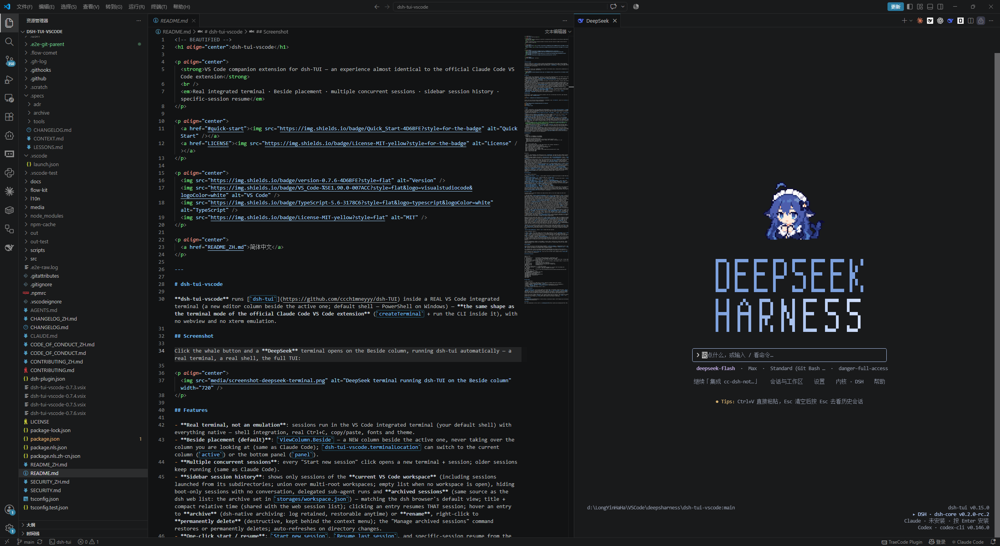
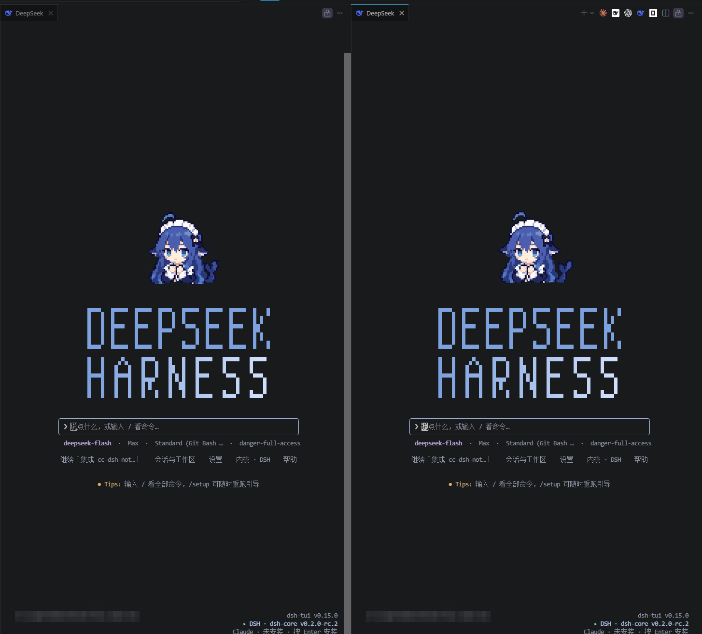
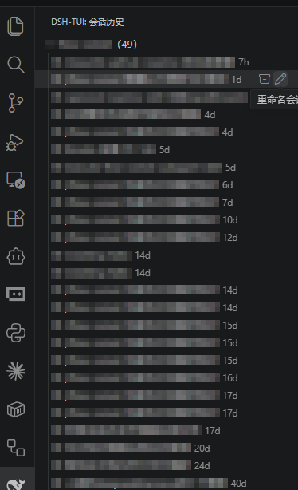
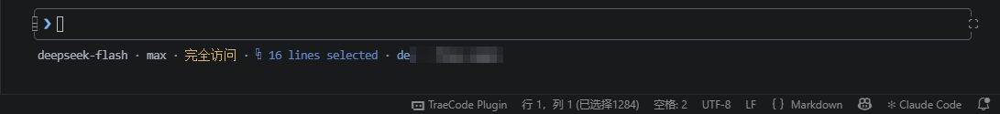
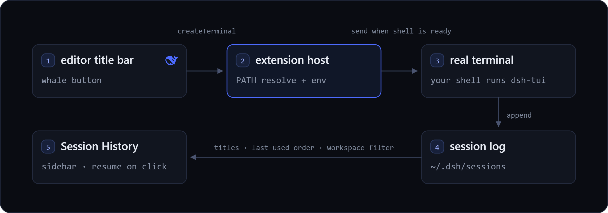

<p align="center">
  
</p>

<p align="center">
  
  
  <a href="LICENSE"></a>
</p>

<p align="center">
  <a href="https://github.com/baobaolaodie/dsh-tui-vscode/actions/workflows/ci.yml"></a>
  <a href="https://marketplace.visualstudio.com/items?itemName=baobaolaodie.dsh-tui-vscode"></a>
  <a href="https://github.com/baobaolaodie/dsh-tui-vscode/releases"></a>
  <a href="https://github.com/baobaolaodie/dsh-tui-vscode"></a>
</p>

<p align="center">
  <a href="README.md">English</a>
</p>

---

**dsh-tui-vscode** 让 [`dsh-tui`](https://github.com/ccch1mneyyy/dsh-TUI) 跑在 **VS Code 真实的集成终端**里——与 Claude Code 官方 VS Code 扩展的终端模式同构（`createTerminal` + 在终端内运行 CLI）。没有 webview、没有 xterm 模拟层：就是你的 shell、你的字体、完整的 TUI。

点一下，**在编辑器旁新开一列**；再点一下，又是一个并行会话，前一个继续跑。侧边栏列出当前工作区的会话，点一条就精确恢复那个会话。

## 界面实拍

点编辑器标签栏的鲸鱼按钮，一个 **DeepSeek** 终端就在编辑器旁那一列打开，并在你的 shell 里运行 dsh-tui——真实终端、真实 shell、完整 TUI：

<p align="center">
  
</p>

再点一下，又会多一个各自占一列的会话；它不复用任何东西，也不会替你杀掉任何会话。下图两个会话并排运行，两者的页脚都显示 dsh-tui v0.15.0：

<p align="center">
  
</p>

侧边栏列出当前工作区的会话、标题与相对时间。点一条即恢复该会话；悬停给出归档与重命名，右键则永久删除。（本图中的会话标题已打码——它们记录的是真实工作内容。）

<p align="center">
  
</p>

而在编辑器里选中代码，无需复制粘贴就能抵达运行中的会话。下图里 VS Code 状态栏报告了编辑器侧的选区，TUI 则以它收到的行数回应：

<p align="center">
  
</p>

## 安装

**1 — 安装 CLI 与 TUI。** 两者都是 npm 包；首次启动会初始化 dsh-tui profile，且需要 `PATH` 上有 [`pnpm`](https://pnpm.io/)：

```sh
npm install -g pnpm
npm install -g @deepseek-ai/dsh @deepseek-harness-tui/dsh-tui
```

需要 Node **^22.19 或 >= 24**。

**2 — 安装扩展。** 在扩展面板（`Ctrl+Shift+X`）搜索 `dsh-tui` 并安装 **dsh-tui (VS Code)**，或直接打开 [Marketplace 页面](https://marketplace.visualstudio.com/items?itemName=baobaolaodie.dsh-tui-vscode)。若要从源码构建，则需要 `PATH` 上有 `code` CLI：

```sh
git clone https://github.com/baobaolaodie/dsh-tui-vscode.git
cd dsh-tui-vscode
npm install
npm run install:local
```

**3 — 给它一个模型。** 或者在启动 VS Code 前导出 `DEEPSEEK_API_KEY`，或者在 TUI 里用 `/auth login deepseek-account` 登录（DSH 0.2.0-rc.1 及更新版本）；其他服务商可通过 `/provider` 或 `/auth` 接入。

## 特性

- **真实终端，不是模拟** —— 会话跑在 VS Code 集成终端里、用你的默认 shell，因此 shell 集成、Ctrl+C、复制粘贴、字体与主题全部原生。
- **默认开在另一侧** —— 在你正在用的那一列旁边新开一列，绝不覆盖它。`dsh-tui-vscode.terminalLocation` 可改为复用当前列（`active`）或底部面板（`panel`）。
- **想开几个会话就开几个** —— 每次启动都是新终端；不复用、也不会替你杀掉任何会话。
- **懂你工作区的会话侧边栏** —— 标题、相对时间、点击即恢复；悬停可归档或重命名，右键可永久删除。
- **选区免复制粘贴** —— 选中代码即经 IDE 选区通道送达运行中的 TUI，或按 `Ctrl+Alt+K` 显式插入 `@相对路径#L12-14` 引用。
- **启动、恢复、终止** —— 恢复上次会话或侧边栏里的任意会话；关掉标签页只结束那一个。

## 兼容性

本扩展只是一层薄壳，下列能力本身长在 dsh-tui 里，所以每一条都有一个上游最低版本。

| 能力 | 要求 |
| --- | --- |
| 扩展本体 | VS Code **≥ 1.90.0**，且已全局安装 `dsh` CLI 与 `dsh-tui` |
| 引用里的 `@路径#L12-14` 行区间 | dsh-tui **≥ 0.9.1** —— 更旧的版本会提示文件未找到 |
| 终端内真实栅格图（`sixel`、`none`） | dsh-tui **≥ 0.10.0**；见[终端图片](#终端图片) |
| 选区自动上下文（IDE 选区通道，协议 v2） | dsh-tui **≥ 0.11.0** |
| 上述能力的扩展侧 | 选区通道需 dsh-tui-vscode **≥ 0.7.0**，图像协议变量需 **≥ 0.7.5** |

除了最低版本，dsh-tui 可以自由前进：上面这两个接口已针对 0.15.0 复核过，自上述版本以来没有变化。

## 工作方式

<p align="center">
  
</p>

- **会话 = 真实终端。** 扩展只负责调用 `createTerminal` 并发送启动命令；进程、信号、滚动缓冲与剪贴板全部归终端所有。启动命令按**扩展宿主**的 `PATH` 解析为绝对路径——登录 shell 会重建 `PATH`，不可信。
- **指定会话恢复走环境变量。** 会话 id 以 `DSH_TUI_RESUME_SESSION` 导出，由 profile 的 `cordis.patch.yml` 在启动时读取。这条路径上刻意**不传** `--resume`——裸 `--resume` 会让启动器用 `~/.dsh-tui/resume.txt` 覆盖该变量。
- **侧边栏容错地读日志。** 会话日志是多帧串联的 zstd；扩展只在 64 KB 头部与 128 KB 尾部这两个有界窗口里逐帧解码，标题依次回退到日志的 `session/title` 事件、dsh storage 账本、首条真人消息，最后是工作目录名。

## 命令

命令面板条目统一归在 **`dsh-tui`** 分类下，标题跟随你的 VS Code 显示语言。

| 命令 | 作用 |
| --- | --- |
| `dsh-tui: 启动新会话` | 新开一个终端并在其中运行 dsh-tui |
| `dsh-tui: 恢复上次会话` | 带 `--resume` 运行 dsh-tui（读 `~/.dsh-tui/resume.txt`） |
| `dsh-tui: 打开 dsh-TUI` | 编辑器标签栏按钮；等同于启动一个会话 |
| `dsh-tui: 聚焦会话面板` | 把最近的会话终端调到前台，没有则新启一个 |
| `dsh-tui: 恢复会话` | 恢复侧边栏中选中的那个会话 |
| `dsh-tui: 插入 @文件引用` | 把当前文件或选区键入会话终端——没有会话终端时改为复制到剪贴板 |
| `dsh-tui: 终止会话` | 向最近的会话终端发送 Ctrl+C |
| `dsh-tui: 重命名会话` / `归档会话` / `永久删除会话` | 会话侧边栏动作 |
| `dsh-tui: 管理已归档会话` | 恢复或永久删除已归档会话 |
| `dsh-tui: 刷新会话列表` | 重新读取会话列表 |

**插入引用。** 编辑器聚焦时按 `Ctrl+Alt+K`（macOS 为 `Cmd+Alt+K`），或用编辑器右键菜单。单行得到 `@相对路径#L12`，选区得到 `@相对路径#L12-14`，未选中则是裸相对路径；工作区之外的路径回退为绝对路径。没有可键入的会话终端时，引用改为进入剪贴板；而比 dsh-tui 活得更久的会话终端仍会收到它。dsh-TUI 在提交时按行区间切片附加内容，而不是把整个文件读进去。

## 设置

| 设置 | 默认 | 说明 |
| --- | --- | --- |
| `dsh-tui-vscode.command` | `dsh-tui` | 启动命令。可能时按扩展宿主的 PATH 解析；解析不出来的名字会原样发送。 |
| `dsh-tui-vscode.extraArgs` | `[]` | 追加的 CLI 参数，如 `["--lang","en"]` |
| `dsh-tui-vscode.terminalLocation` | `editor` | `editor`（活动列旁新开一列）/ `active`（当前列）/ `panel`（底部面板） |
| `dsh-tui-vscode.lang` | `""` | `""` / `zh` / `en`，导出为 `DSH_TUI_LANG` |
| `dsh-tui-vscode.imageProtocol` | `sixel` | 导出给 `DSH_TUI_IMAGE_PROTOCOL` 的取值：`sixel`、`none`，或 `auto`（移除该变量）。见[终端图片](#终端图片)。 |
| `dsh-tui-vscode.injectEditor` | `true` | 当扩展宿主看到的环境里 `$VISUAL` 与 `$EDITOR` 都未设置时导出 `$VISUAL` |
| `dsh-tui-vscode.editorCommand` | `code -w` | 导出为 `$VISUAL` 的值 |
| `dsh-tui-vscode.dshHome` | `""` | 为会话覆盖 `$DSH_HOME`（空 = 继承） |
| `dsh-tui-vscode.autoInsertMention` | `true` | 把编辑器选区推送给运行中的 TUI（300ms 防抖） |

会话拿到的环境变量不止这些：`DSH_TUI_IMAGE_PROTOCOL`（除非 `imageProtocol` 为 `auto`——那会移除它），选区通道可用时还有 `DSH_TUI_IDE_PORT` 与 `DSH_TUI_IDE_TOKEN`，恢复指定会话时还有 `DSH_TUI_RESUME_SESSION`（以及 `DSH_CC_RESUME_SESSION`）。

## 终端图片

吉祥物立绘与图片预览，只有**同时**满足下列条件时才渲染为真实栅格图：

1. **`terminal.integrated.enableImages` 为 `true`**（VS Code 默认 `false`）。某次会话启动时若该设置未开，扩展会提供一次「启用并重载窗口」的一键路径——但若你把 `imageProtocol` 设为 `none`，或 `gpuAcceleration` 已使 WebGL 渲染器不可用，则不提供：这两种情况都不是打开它就能解决的。扩展绝不在未经确认时改写你的设置；若你的工作区或文件夹设置已固定该值，它也不去硬碰，而是给出手动指引。
2. **`terminal.integrated.gpuAcceleration` 不能使 WebGL 渲染器不可用** —— 留在 `auto`（默认）或设为 `on`。图像 addon 只挂在 WebGL 渲染器上，所以 `off` 时无论怎么改都出不了图。
3. **dsh-tui 为 0.10.0 或更新**，这是它能识别 `DSH_TUI_IMAGE_PROTOCOL` 的起点。更旧的版本会静默忽略该变量。在 Windows 上，VS Code 自己的描述还补了一条：图像协议需要 ConPTY v2 或更新，而它随 Windows 一同提供。

开启 `enableImages` 只对之后重载过的窗口生效，所以打开它之后请**重载窗口**：在那之前，扩展读的是窗口启动时的值，会持续导出 `none`——此时的图像区域显示半块字符画，而不是一片空白。处于这个状态时，每次会话启动都会提醒你重载。

`dsh-tui-vscode.imageProtocol` 决定导出什么：

| 取值 | 导出值 | 行为 |
| --- | --- | --- |
| `sixel`（默认） | `sixel` | 上述条件满足时显示真实栅格图，否则退成半块字符画 |
| `none` | `none` | 始终半块字符画；启用引导同样被抑制 |
| `auto` | *（移除）* | 把该变量从会话环境中**移除**，交回 dsh-TUI 自行判定 |

`auto` 是移除该变量，而不只是「不写它」——因为 VS Code 会把这份环境叠加在终端原本要继承的环境之上，来自你 shell profile 的值仍会抵达 dsh-tui 并把它悄悄钉在某个协议上。

**已验证组合**：Windows 11 (10.0.26200) + VS Code 1.140.0 + dsh-TUI 0.15.0——本扩展的真实扩展宿主 e2e 套件在此通过，其中包含「恢复一个真实 dsh-tui 会话」的受保护用例，以及终端启动、环境注入、图像门禁与 IDE 通道的断言。其他平台、远程环境与其他 VS Code 版本**均未验证**；字符画兜底保证最差情况仍是可见内容而非空白。完整版——包括这道门禁为何保守、以及哪些问题仍未解决——见 [docs/terminal-images_ZH.md](docs/terminal-images_ZH.md)。

## 故障排查

| 症状 | 怎么办 |
| --- | --- |
| 提示找不到 `dsh-tui` | 它必须全局安装。用 `npm ls -g --depth=0` 确认；若你的 shell 能找到而 VS Code 不能，把 `dsh-tui-vscode.command` 设为绝对路径。 |
| TUI 渲染成灰阶 | 有东西把 `NO_COLOR` 或 `TERM=dumb` 导进了终端环境。请从普通 shell 启动 VS Code。 |
| `Ctrl+Alt+K` 没反应 | opencode 占用了同一个默认键。在**键盘快捷方式**（`Ctrl+K Ctrl+S`）里搜索 `dsh-tui` 或 `insertAtMention` 重绑；右键菜单与命令面板入口不受影响。 |
| `@` 引用提示文件未找到 | dsh-TUI 低于 0.9.1，解析不了 `#L` 区间。升级它。 |
| 图片显示为块状字符 | `enableImages` 未开，或开启后没有重载窗口，或 `gpuAcceleration` 为 `off`。见[终端图片](#终端图片)。 |
| 侧边栏是空的 | 所有会话都属于别的工作区。请打开会话启动时所在的那个文件夹。 |
| 侧边栏列出了一堆不相干的会话 | 没有打开文件夹，列表便无从按目录收窄。打开一个文件夹即可。 |
| 重命名后会话标题没变 | 运行中的 TUI 在重新读取日志前看不到新标题；重新打开该会话即可。 |
| 我删掉的会话还在磁盘上 | 「永久删除」会移除会话目录。已归档会话保留日志，用 `dsh-tui: 管理已归档会话` 恢复。 |

## 界面语言

扩展自身的 UI——命令标题、视图名、设置描述与运行时文案——跟随你的 **VS Code 显示语言**，走标准的 `package.nls*.json` + `vscode.l10n` 机制，默认英文、缺翻译自动回退。要获得中文界面，请安装 **中文（简体）语言包**并重启 VS Code。

这与 `dsh-tui-vscode.lang` 相互独立：后者设置 `DSH_TUI_LANG`，只影响 **TUI 自身**的语言。

## 开发

```sh
npm run compile       # tsc -> out/
npm run typecheck     # tsc --noEmit
npm test              # node:test 数据层单测
npm run test:e2e      # 真实扩展宿主（@vscode/test-electron）
npm run package       # 构建 .vsix
```

TypeScript 5.6 编译为 CommonJS，只有两个运行时依赖：`@bokuweb/zstd-wasm` 用于会话日志解压，`ws` 用于回环 IDE 通道服务端。CI 在 Linux 与 Windows 上跑 Node 22/24 矩阵的单测，并在 Linux + xvfb 下跑真实扩展宿主。

源码树布局、CI 强制的内容与发布清单见 [CONTRIBUTING_ZH.md](CONTRIBUTING_ZH.md)。

## 许可

MIT © 2026 baobaolaodie。dsh-tui 本体为 [ccch1mneyyy/dsh-TUI](https://github.com/ccch1mneyyy/dsh-TUI)，同为 MIT。
